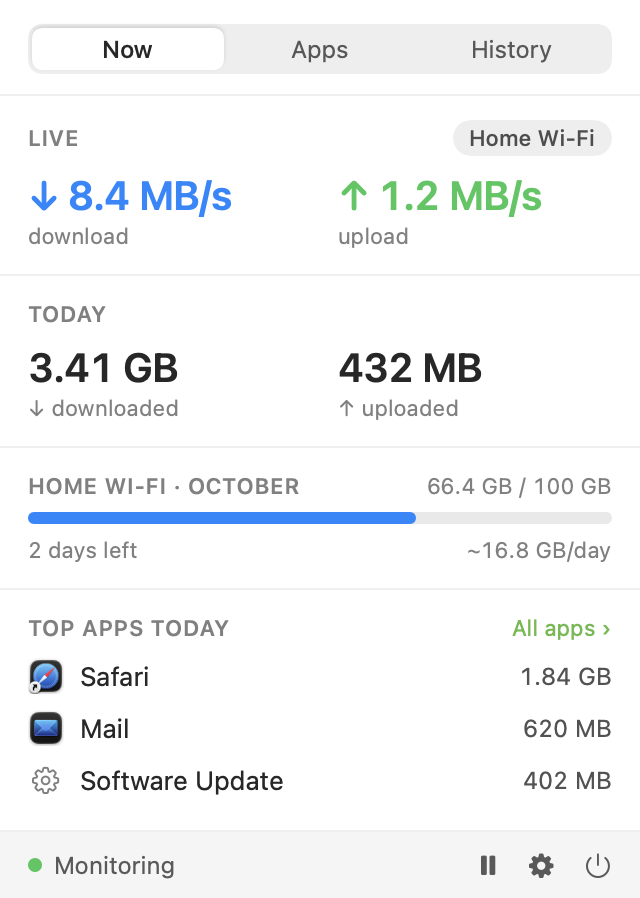
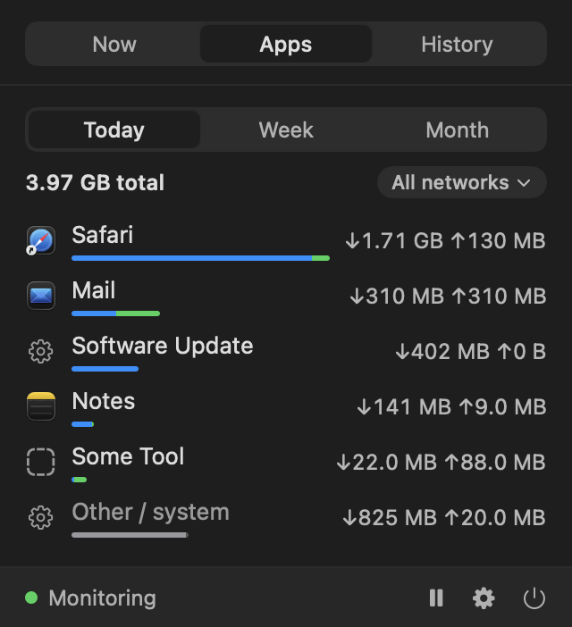
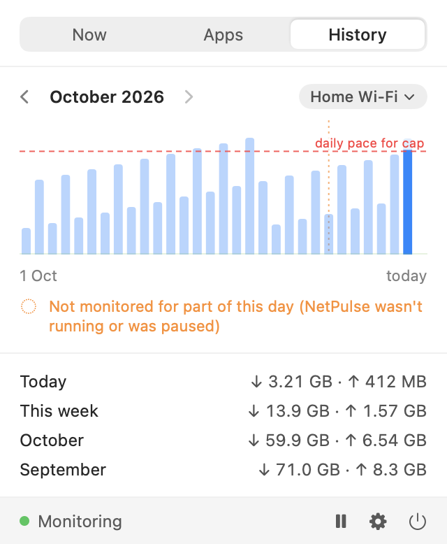

# NetPulse

NetPulse is a native macOS menu bar app that shows live network speed and how much traffic this Mac has used, per app, per network and over time. It runs entirely on your Mac: no telemetry, no accounts, no network calls of its own.

**Website:** https://venkataphanindravutla.github.io/NetPulse/ · **Download:** [latest release](https://github.com/venkataPhanindraVutla/NetPulse/releases/latest)

- Live download and upload speed in the menu bar (stacked, single line, download-only or icon-only).
- Per-app usage for today, this week and this month, filterable by network.
- Per-network totals with optional daily and monthly caps, and a notification at 80% and 100%.
- A daily history chart for each month. Days when NetPulse wasn't running or was paused are marked.

<p>
  
  
  
</p>


All screenshots are rendered with sample data by the app's debug harness, not captured from a real session. The last image shows the paused icon and two stacked label renders.

## Requirements

- macOS 14 or later (developed on macOS 26.6, Apple Silicon).
- Xcode (developed with 27.1; Swift 6 language mode) and [xcodegen](https://github.com/yonaskolb/XcodeGen).

NetPulse is not distributed as a binary yet. You build it yourself.

## Build

```sh
brew install xcodegen
git clone <this repo> && cd NetPulse

# Optional: sign with your own team so macOS keeps your permissions across rebuilds.
cp Config/Local.xcconfig.example Config/Local.xcconfig
# edit Config/Local.xcconfig and set DEVELOPMENT_TEAM to your team ID
# (security find-identity -v -p codesigning)

xcodegen generate
xcodebuild -project NetPulse.xcodeproj -scheme NetPulse -configuration Release \
  -derivedDataPath .build/xcode build
open .build/xcode/Build/Products/Release/NetPulse.app
```

Or open `NetPulse.xcodeproj` in Xcode and run the `NetPulse` scheme. Without `Config/Local.xcconfig` (it is git-ignored) the app builds ad hoc ("Sign to Run Locally"); that works for running it locally. The ad hoc build still has the hardened runtime on (`codesign -dv` shows `flags=0x10002(adhoc,runtime)`), but an ad hoc signature has no stable identity, so macOS may ask for permissions again after each rebuild.

The app has no Dock icon. Look for it in the menu bar.

### If you cannot see the menu bar item

On macOS 26 a new menu bar item can be registered but hidden. Open System Settings › Menu Bar and allow NetPulse, and/or free space to the right of the notch (quit or hide other menu bar items, or Command-drag NetPulse to the right).

## Tests

The core logic lives in the Swift package `NetPulseCore` and is tested without the app:

```sh
swift test
```

### netpulse-probe

`netpulse-probe` is a command-line harness around the same engine, used for the measurements below.

```sh
swift build -c release
.build/release/netpulse-probe --seconds 60                  # sample and print a summary
.build/release/netpulse-probe --seconds 600 --db /tmp/p.sqlite --nettop-interval 5
.build/release/netpulse-probe --network                     # print the detected network
```

## Permissions

- **Location**: asked once, at first run. It is used only to read your Wi-Fi network's name (CoreWLAN returns no name without it), so usage can be tracked per network. Your location is never read, stored or sent. If you decline, networks are identified by a router fingerprint (the gateway's MAC address) and shown as "Wi-Fi network"; you can rename them in Settings.
- **Notifications**: asked only when you first enable a cap. Without them the caps still show in the popover (amber at 80%, red at 100%).
- **Launch at login**: the popover offers it once ("Turn on" / "Not now"), and it can be toggled in Settings › General. It uses the standard login item mechanism and shows up in System Settings › General › Login Items.

## How it measures

- **Interface totals** (live speed and network totals) come from the kernel's 64-bit interface counters (`sysctl` `NET_RT_IFLIST2`), sampled every second. Loopback and virtual interfaces (VPN tunnels, bridges, AWDL and similar) are not added on top of physical ones, so VPN traffic is counted once, on the interface it leaves through.
- **Per-app usage** comes from `/usr/bin/nettop`, run as one child process in delta mode, every 10 seconds in the app (live speed still updates every second), limited to Wi-Fi and wired interfaces (`-t wifi -t wired`) so a VPN's tunnel traffic is not counted a second time. Process IDs are mapped to their `.app` bundle, so helpers roll up to the parent app (all Chrome helpers become "Google Chrome"). Background services such as WebKit's networking process are assigned to the app that owns them using a private macOS lookup; if that fails they appear under "Apple WebKit".
- **Other / system** is the interface total minus everything attributed to apps, never below zero. It is always listed so the numbers visibly add up. It collects traffic nettop does not attribute to a process: ACK and header overhead, kernel and system traffic, and bytes from processes that started and exited between two samples. Outbound "Other" is large while you download, because acknowledgements and headers count on the interface but not in nettop's per-socket byte counts.
- **Device traffic, not ISP billing.** The numbers are what this Mac sent and received at the interface. Your provider may count differently (other devices, hotspot sharing, protocol overhead, their own measurement window), so do not treat a cap here as your provider's bill.
- **Storage**: usage is kept in 15-minute UTC buckets and aggregated in your current time zone, so local day, week and month boundaries are exact, including half-hour offsets. Writes are flushed every 30 seconds and on quit or sleep.
- **No data while NetPulse is not running.** It cannot count traffic when it is off or paused; those days are marked "Not monitored for part of this day". Sleep and nettop restarts are logged as gaps too but do not mark a day: no traffic flows while the Mac sleeps, and a nettop restart only interrupts the per-app split, not the totals.

### Measured accuracy and CPU

Measured on one Mac (macOS 26.6, Apple Silicon, Wi-Fi), with `netstat -ib -I en0` as the reference:

- Interface counters vs `netstat` over a 150 s download: ratio 0.9999 (down), 0.999 under upload load.
- Sum of attributed apps vs interface total: about 0.91 to 0.96 downloading, about 0.90 uploading. The rest is "Other / system".
- A curl download was attributed to curl within 0.24% of the payload size.
- CPU, NetPulse plus its nettop child together, shipping app (Release build, stacked menu bar label, popover closed, 600 s, cumulative `ps` CPU time): **0.97%** combined (NetPulse 0.59% + nettop 0.38%), under the 1% budget, narrowly. The app samples per-app usage every 10 s; live speed stays at 1 s. nettop's share varied from 0.38% to 0.73% across runs depending on network activity, so on a busy network expect the total to sit near or above 1%. For reference, the engine alone (the `netpulse-probe` harness, 5 s nettop cadence) used 0.48 to 0.54%. Earlier app history: 1.44%, then 1.16% after the AppKit label, then 1.28% with a fixed-length item, then 0.97% with the 10 s nettop cadence. Light menu bar and mixed-DPI rendering was not verified on a second display.

Details and raw numbers: [docs/superpowers/spikes/2026-10-28-findings.md](docs/superpowers/spikes/2026-10-28-findings.md).

## Privacy and your data

NetPulse makes no network calls and has no update checker. Everything is stored in one SQLite file:

```
~/Library/Application Support/NetPulse/usage.sqlite
```

To delete your history, quit NetPulse and remove that file (or the `NetPulse` folder). Settings live in the app's defaults; `defaults delete io.github.netpulse.NetPulse` resets them.

## Known limits

- **Not on the Mac App Store and not sandboxed.** Per-app attribution needs `/usr/bin/nettop`, which the App Sandbox does not allow. The hardened runtime is on in every build, ad hoc included.
- **Short-lived processes** that start and exit between two 10 s samples may be missed and land in "Other / system".
- **WebKit attribution** relies on a private API; if it stops working traffic goes to an "Apple WebKit" bucket rather than a guess.
- **Several active networks at once** (for example Wi-Fi plus Ethernet): the app switches to one nettop per interface type so per-network app sums stay honest. This mode has been tested logically but its CPU cost has not been measured.
- **Per-app numbers on a network are assigned to whichever network was primary** during each 10 s window.
- **Caps cover network totals only**, not individual apps.
- **Menu bar visibility on macOS 26**: see "If you cannot see the menu bar item" above.
- Decimal units (1 GB = 1,000,000,000 bytes). Rates can be shown as MB/s or Mbps in Settings.

## License

MIT. See [LICENSE](LICENSE).
